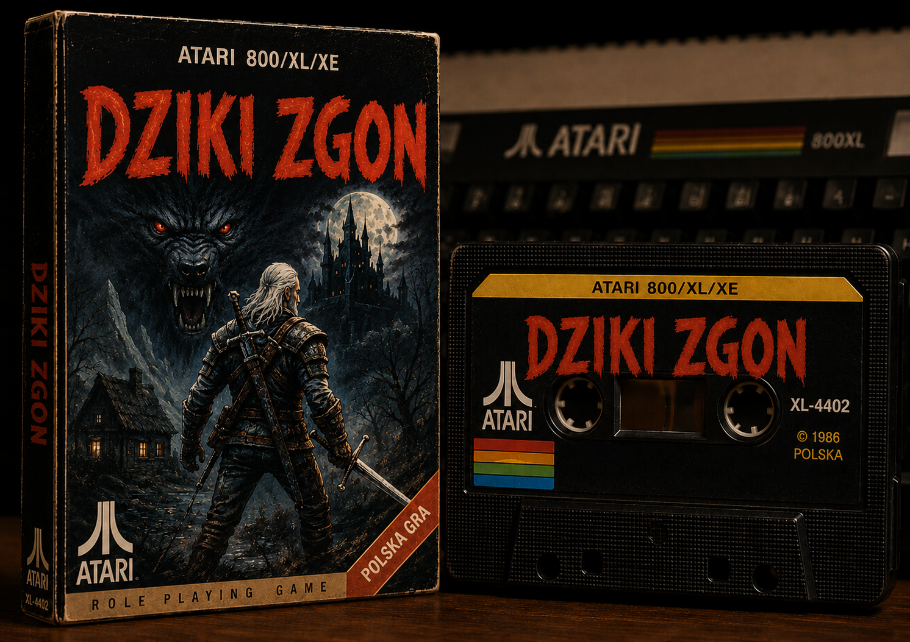

# Dziki Zgon 🐺💀

Przygodowo-zręcznościowa gra z widokiem z góry na **Atari 800 XL / 65 XE** — humorystyczna parodia Wiedźmina.

- Tytuł AAA (Atari Action Adventure)
- Otwarty Świat
- Nieliniowa fabuła
- Kraftowe poziomy i grafika



## Fabuła

Po wielodniowej imprezie w karczmie "Pod Trzema Kuflami" wiedźman **Gerwant** budzi się z potężnym kacem. Nie pamięta gdzie jest Plotka, gdzie są miecze, ani skąd wziął się rachunek na 18 000 orenów. Wyrusza w podróż przez 5 regionów, by odzyskać swój dobytek, wspomnienia i resztki godności.

## Development z AI agentami

Agent AI powinien przeczytać oraz postępować wg zasad umieszczonych w pliku [AGENTS.md](.agents/AGENTS.md).

Kontekst techniczny jest także zawarty w plikach [AI_CONTEXT.md](AI_CONTEXT.md), [ARCHITECTURE.md](ARCHITECTURE.md), [MEMORY_USAGE.md](MEMORY_USAGE.md), [SPRITES.md](SPRITES.md), [RULES.md](RULES.md) i [TEST_PLAN.md](TEST_PLAN.md).

## Założenia

- Gra działa na **gołym** Atari 800 XL / 65 XE z **64 KB RAM** — bez rozszerzeń pamięci, bez cartridge'ów.
- Obsługa wyłącznie **joysticka** i przycisku **FIRE** — bez klawiatury.
- Jeden plik wykonywalny `.XEX` ładowany z dowolnego DOS-a (lub bootowalny z dyskietki).
- Grafika w trybach **ANTIC E** (obraz tytułowy), **ANTIC 2** (stopka tytułu, ekrany opisu, podróży i końca gry, panel statusu) oraz **ANTIC 5** (mapa rozgrywki 40×12 znaków).
- Postacie na PMG: 4-kolorowy bohater (P0+P1), przeciwnicy na P2, P3 oraz piątym graczu (M0–M3).
- Rozgrywka i sterowanie płynne w **50 FPS** (PAL).
- Kod pisany w asemblerze **MADS**, bez zależności od BASIC-a ani cartridge'ów.
- Cały kod i dane mieszczą się poniżej `$C000` (OS ROM pozostaje włączony); układ pamięci jest automatycznie weryfikowany przy każdym buildzie (`scripts/check_memory.py` → [MEMORY_USAGE.md](MEMORY_USAGE.md)).

## Struktura projektu

```
witcher-atari-game/
├── main.asm                     # Punkt startowy, maszyna stanów (title→story→game→gameover), mapa segmentów
├── hardware.asm                 # Definicje rejestrów GTIA/ANTIC/POKEY/PIA i stałe gry
├── zeropage.asm                 # Zmienne page zero ($80–$D4)
├── Makefile                     # Automatyzacja budowania
├── requirements.txt             # Zależności Pythona
├── engine/                      # Silnik gry
│   ├── engine.asm               # Inicjalizacja silnika
│   ├── engine_frame.asm         # Obsługa ramki / VBLANK
│   ├── engine_scheduler.asm     # Deterministyczny potok ramki
│   ├── input.asm                # Odczyt joysticka
│   ├── actor.asm                # System aktorów (SoA)
│   ├── player.asm               # Ruch i sterowanie gracza (Gerwanta)
│   ├── npc.asm                  # AI przeciwników / NPC
│   ├── collision.asm            # Wykrywanie i obsługa kolizji
│   ├── animation.asm            # Animacje sprite'ów
│   ├── charset_anim.asm         # Animowane / obracane znaki
│   ├── render.asm               # Renderowanie PMG i świata
│   ├── world.asm                # Nawigacja po ekranach i regionach
│   ├── iis.asm                  # Obiekty interaktywne
│   ├── secret_object.asm        # Sekrety
│   ├── inventory.asm            # Ekwipunek
│   ├── quest.asm                # Logika questów
│   ├── dialogue.asm             # Dialogi
│   ├── msg_line.asm             # Linia komunikatów
│   ├── travel_screen.asm        # Ekran podróży między regionami
│   └── audio.asm                # Efekty dźwiękowe (mailbox SFX)
├── lib/
│   ├── pmg.asm                  # Procedury pomocnicze PMG
│   ├── rle.asm                  # Wspólny dekompresor RLE (6502)
│   ├── text_headers.asm         # Nagłówki tekstów
│   └── world_renderer.asm       # Rysowanie ekranów mapy
├── audio/                       # Odtwarzacz i utwory muzyczne (POKEY)
│   ├── dziki-zgon-title.dsl     # Motyw ekranu tytułowego (Music DSL)
│   ├── dziki-zgon-intro.json    # Motyw ekranu intro / story
│   ├── dziki-zgon-travel.json   # Motyw ekranu podróży
│   ├── dziki-zgon-game-over-failure.json # Motyw końca gry (porażka)
│   ├── dziki-zgon-game-over-success.json # Motyw końca gry (sukces)
│   ├── player.asm               # 4-kanałowy relokowalny odtwarzacz POKEY
│   └── audio.asm                # Sterownik audio dla scen gry
├── scenes/
│   ├── title/title.asm          # Ekran tytułowy (ANTIC E + stopka ANTIC 2, DLI, tęcza)
│   ├── story/story.asm          # Ekran opisu (ANTIC 2)
│   ├── game/game.asm            # Gra właściwa (ANTIC 5 + panel ANTIC 2)
│   └── gameover/gameover.asm    # Ekran końca gry (ANTIC 2)
├── sprites/                     # Sprite'y postaci (*.sprite.json, 2- i 4-kolorowe)
├── chars/                       # Definicje znaków animowanych i obracanych (JSON)
├── texts/                       # Teksty źródłowe (story, game over, podróże, title.txt z wersją)
├── fonts/
│   ├── font.fnt                 # Czcionka ekranów tekstowych ($6000)
│   └── game.fnt                 # Czcionka rozgrywki ($6400)
├── img/                         # Obrazy źródłowe (tytuł, księżyc, napis, ekrany)
├── world/                       # SSOT świata w YAML (world, regiony, obiekty, przedmioty, wrogowie)
├── scripts/                     # Konwertery i narzędzia buildu
│   ├── img2asm.py               # PNG/BMP/GIF → .bin + .asm + DL + kolory
│   ├── sprite2asm.py            # *.sprite.json → ASM (bitplany PMG)
│   ├── png2sprite.py            # PNG → *.sprite.json
│   ├── fnt2asm.py / fnt2png.py / png2fnt.py # Konwersje czcionek
│   ├── gen_animated_charset.py  # Znaki animowane → ASM
│   ├── gen_rotated_charset.py   # Znaki obracane → ASM
│   ├── rle_compress_text.py     # Kompresja RLE tekstów
│   ├── gen_texts_list.py        # Agregacja tekstów (gen/all_texts.asm)
│   ├── compile_music.py         # Music DSL / JSON → ASM (atari-music)
│   ├── check_memory.py          # Walidacja mapy pamięci XEX
│   ├── generate_memory_map.py   # Raport i PDF mapy pamięci
│   ├── export_portal_data.py    # Eksport danych dla portalu WWW
│   ├── verify_memory_integrity.py # Weryfikacja integralności pamięci
│   ├── release_helper.py        # Wersjonowanie wydań (CI)
│   └── ...                      # Narzędzia pomocnicze (obiekty, debug, dokumentacja)
├── world_builder/               # Kompilator świata (YAML → ASM)
├── world_studio/                # Edytor map świata (PySide6)
├── object_studio/               # Edytor obiektów (PySide6)
├── sprite_studio/               # Edytor sprite'ów (PySide6)
├── debug_bridge/                # Most emulator ↔ zewnętrzny debugger
├── atari_smoke_test/            # Testy dymne w emulatorze
├── tests/                       # Testy jednostkowe i integracyjne (pytest, py65)
├── website/                     # Portal gry (Astro + Tailwind, GitHub Pages)
├── reports/                     # Wygenerowane raporty (m.in. dane portalu)
├── docs/                        # Dokumentacja sprzętu i narzędzi
├── .github/workflows/           # CI: release.yml (wydania), portal-deploy.yml (portal)
└── gen/                         # Pliki generowane — nie edytować ręcznie
```

## Wymagania

| Narzędzie | Wersja | Uwagi |
|---|---|---|
| [MADS](https://mads.atari8.info/) | 2.1.6 | Asembler 6502 dla Atari 8-bit |
| [Python](https://www.python.org/) | 3.12+ | Skrypty buildu, kompilatory danych, edytory, testy |
| [GNU Make](https://www.gnu.org/software/make/) | — | Automatyzacja buildu |
| [Pillow](https://python-pillow.org/), [NumPy](https://numpy.org/) | 12.x / 2.x | Przetwarzanie obrazów |
| [PyYAML](https://pyyaml.org/), [Pydantic](https://docs.pydantic.dev/) | 6.x / 2.x | Parsowanie i walidacja danych świata |
| [PySide6](https://doc.qt.io/qtforpython-6/) | 6.x | Edytory GUI (World / Object / Sprite Studio) |
| [pytest](https://pytest.org/), [py65](https://github.com/mnaberez/py65) | — | Testy jednostkowe i emulacja 6502 |
| [Atari Music Composer](https://github.com/grzes71/atari-music-composer) (`atari-music`) | 0.8.0 | Kompilacja muzyki POKEY (instalowany z `requirements.txt`) |
| [Atari Image Converter](https://github.com/grzes71/py-image-converter/#atari-image-converter) | 0.3.0 | Konwersja obrazów na formaty Atari (instalowany z `requirements.txt`) |
| Emulator Atari | — | Np. [Altirra](https://www.virtualdub.org/altirra.html) / AltirraSDL, Atari800 |
| [Node.js](https://nodejs.org/) | 22 | Opcjonalnie — tylko do budowania portalu (`website/`) |
| [html-to-markdown](https://github.com/grzes71/html-to-markdown#html-to-markdown) | — | Opcjonalnie — konwersja dokumentacji HTML do Markdown |

Wszystkie pakiety Pythona instaluje `pip install -r requirements.txt`.

## Development (Windows)

Poniżej znajduje się opis kroków potrzebnych, aby zacząć development gry na systemie Windows:

1. Instalacja chocolatey (https://chocolatey.org/install#individual)
2. Instalacja za pomocą `choco install`:
   - `git`
   - `python`
   - `make`
3. Instalacja Mad-Assembler (https://github.com/tebe6502/Mad-Assembler/releases/tag/2.1.6) w lokalizacji `C:\Apps\Mad-Assembler-2.1.6` (inną ścieżkę można podać przez `make MADS=...`)
4. Instalacja emulatora Altirra (np. do lokalizacji `C:\Apps\Altirra-4.40`) lub AltirraSDL (do testów automatycznych przez AltirraBridge)

> Na Linux/macOS Makefile domyślnie używa `/usr/local/bin/mads` i `python3`.

### Tworzenie środowiska wirtualnego

Aby zainstalować pakiety Pythona, utwórz i aktywuj środowisko wirtualne, a następnie zainstaluj zależności (Makefile automatycznie wykrywa `.venv`):

```bash
python -m venv .venv
.venv\Scripts\activate
pip install -r requirements.txt
```

## Kompilacja

```bash
# Pełny pipeline: teksty → sprite'y → tło → czcionki → muzyka → świat → XEX → testy → walidacja pamięci
make            # (równoważne: make all)

# Konkretne cele
make texts        # kompresja RLE tekstów: texts/*.txt -> gen/*_text.asm + gen/all_texts.asm
make sprites      # gen/moon.asm, gen/dziki-zgon.asm oraz gen/*.sprite.asm ze sprites/*.sprite.json
make bg           # obraz tytułowy: gen/title.bin, gen/title.rle, gen/title_colors.asm, gen/title_displaylist.asm
make fonts        # czcionki (.fnt -> .asm) oraz znaki animowane / obracane z chars/*.json
make music        # utwory: audio/*.dsl / audio/*.json -> gen/music_*.asm (atari-music)
make world        # świat: world/*.yaml -> gen/world/*.asm
make xex          # asemblacja dziki_zgon.xex
make test         # testy pytest + py65
make check_memory # walidacja mapy pamięci XEX i aktualizacja MEMORY_USAGE.md
make memory_map   # raport + memory_map.pdf (alias: make map)
make smoke-test   # test dymny binarki w emulatorze
make portal_data  # eksport danych portalu do reports/portal/ + weryfikacja integralności pamięci
make clean        # usuwa katalog gen/ oraz plik XEX

# Zmiana obrazu tła
make clean BG_PREFIX=title-0a && make

# Uruchomienie w emulatorze
altirra dziki_zgon.xex
```

### Portal WWW

```bash
make portal_data
cd website
npm install
npm run dev     # lub: npm run build
```

### CI / wydania

- [release.yml](.github/workflows/release.yml) — po scaleniu PR do `main` buduje XEX, podbija wersję (Conventional Commits, `texts/title.txt`) i publikuje wydanie.
- [portal-deploy.yml](.github/workflows/portal-deploy.yml) — buduje i publikuje portal na GitHub Pages.

## Narzędzia

Szczegółowe opisy wszystkich dedykowanych narzędzi, w tym **Konwertera obrazów**, kompilatora **World Builder**, debuggera **Debug Bridge** oraz wizualnych edytorów GUI (**World Studio**, **Object Studio**, **Sprite Studio**), przeniesiono do pliku: [TOOLS.md](TOOLS.md).

## Licencja

Projekt hobbystyczny — do użytku niekomercyjnego.
